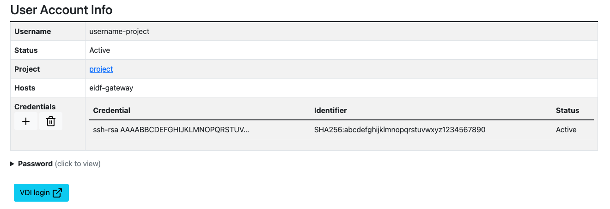

# SSH Access to Virtual Machines using the EIDF-Gateway Jump Host

EIDF virtual machines (VMs) can be accessed via SSH from a terminal or console on your own host. SSH offers an alternative to using the EIDF [Virtual Desktop Interface (VDI)](virtualmachines-vdi.md) to access the EIDF VMs.

Access to EIDF VMs via SSH uses the EIDF-Gateway, a secure 'jump host' which is accessible from anywhere which manages authorised connections from arbitrary hosts to EIDF VMs.

!!! Note "SSH access is not the same as SSH"

    You may have noticed that the EIDF Virtual Desktop Interface allows you to create an SSH session. This is not the same as running an SSH session from your own host, that is described on this page. An SSH session run within the VDI offers the same look-and-feel as an actual SSH session but there is no SSH connection from your host to an EIDF VM.

## Commands and operating systems

OpenSSH available under Linux, Windows 11 (Windows Subsystem for Linux, Powershell, Git Bash) and MacOS. Unless noted otherwise, all commands on this page can be run under any of these environments.

---

## Set up SSH access

To access an EIDF VM via SSH from your terminal or console, you will need:

1. An EIDF project user account to have been created for you.
1. Access to the project VM for your user account to have been granted.
1. Access to the EIDF-Gateway, eidf-gateway.epcc.ed.ac.uk, to have been granted.

The above steps need to be done by your project lead.

Once your account has been created and access granted, you need to set up your SSH access as follows:

1. [Create an SSH private-public key pair](#create-an-ssh-private-public-key-pair) on the host from which you want to access the EIDF VM via SSH.
1. [Add the public key to your account](#add-the-public-key-to-your-account) within the EIDF Portal.
1. [Get a multi-factor authentication app](#get-a-multi-factor-authentication-app).
1. [Set up multi-factor authentication](#set-up-multi-factor-authentication) for your account within the EIDF Portal.

Once you have done these setup steps, you can [connect to the EIDF VM via SSH](#connect-to-an-eidf-vm-via-ssh).

### Create an SSH private-public key pair

To create a SSH private-public key pair on the host from which you want to access the EIDF VM via SSH:

1. Create a `$HOME/.ssh` directory if one does not exist:

    Linux, Windows (Git Bash, Windows Subsystem for Linux), MacOS:

    ```bash
    mkdir -p $HOME/.ssh
    ```

    Windows (Powershell):

    ```powershell
    mkdir -Force $HOME/.ssh
    ```

1. Create an SSH private-public key pair, replacing `<comment>` with a comment (see below) and `<project_id>` with your EIDF project number (e.g., '000'):

    ```bash
    ssh-keygen -C '<comment>' -f $HOME/.ssh/id_ed25519_eidf<project_id>
    ```

    `-C <comment>` is a comment added to the public key that is created, A suitable value for `<commment>` can be your email address, or a username and local host name (e.g., `some-user-laptop` or `some-user-cirrus`), Alternatively, `-C '<comment>'` can be omitted, and the default comment of `<user>@<host>` will be used.

    `-f` specifies the private key file path. We recommend that the file name include the default algorithm used to create the key, `ed25519`, and the EIDF project number, `<project_id>`, in the file name. This can be useful if you have multiple keys for multiple projects or for other services.

    For example:

    ```bash
    ssh-keygen -C 'some-user@somedept.ed.ac.uk' -f $HOME/.ssh/id_ed25519_eidf000
    ```

1. When prompted, enter, then re-enter a passphrase:

    ```bash
    Generating public/private ed25519 key pair.
    Enter passphrase for "/home/some-user/.ssh/id_ed25519_eidf000" (empty for no passphrase):
    Enter same passphrase again:
    ```

    The passphrase is used to protect the key. Whenever you use the key, you will be prompted for the passphrase.

Information about the key will be printed. This will include the file names:

```text
Your identification has been saved in /home/some-user/.ssh/id_ed25519_eidfNNN
Your public key has been saved in /home/some-user/.ssh/id_ed25519_eidfNNN.pub
...
```

Two files will be created in your `.ssh` directory:

* `.ssh/id_ed25519_eidf<project_id>`, the private key file, which includes the private key itself. **Do not** share your private key with anyone.
* `.ssh/id_ed25519_eidf<project_id>.pub`, a complementary public key file, which shares the private key file name with a `.pub` suffix. The public key file has content:

    ```text
    <key-type> <base64-encoded-public-key> <comment>
    ```

    The default `<key-type>` is `ssh-ed25519`.

### Add the public key to your account

To add the public key to your account:

1. On the [Your Projects](https://portal.eidf.ac.uk/project) page within the [EIDF Portal](https://portal.eidf.ac.uk/), click your project.
1. Your selected project's page will appear.
1. Within the 'Your Accounts' table, click your user account name.
1. Your 'User Account Info' page will appear.
1. Under 'Credentials', click the **+ (plus)** button.
1. Either, the paste contents of the public key file, `$HOME/.ssh/id_ed25519_eidf<project_id>.pub`, into the **Credential** field.
1. Or, click **Choose file** and select the public key file, `$HOME/.ssh/id_ed25519_eidf<project_id>.pub`
1. Click **Upload Credential**.
1. The 'User Account Info' page will reappear.

Your public key will be shown in the 'Credentials' table. An excerpt of the start of the public key will be shown under 'Credential' and the public key's comment will be shown under 'Identifier'. Initially, the public key will have a 'Status' of 'Pending'. If you refresh the page, the 'Status' will eventually update to 'Active'.

!!! Warning "Delay in public key being usable"

    There may be a lag, possibly of a few minutes, between a public key being added and it being usable, even if the public key is marked as 'Active'. This is due to the time taken for the update to be reflected across the EIDF infrastructure.

### Get a multi-factor authentication app

When you come to access an EIDF VM with the EIDF-Gateway you will be prompted not only for your SSH key passphrase but also for a time-based one-time password (TOTP). To provide this password you will need to have installed a suitable authenticator app on your mobile device. There a many such apps available. Popular options include:

* [Apple Passwords app](https://support.apple.com/en-gb/120758)
* [Google Authenticator](https://play.google.com/store/apps/details?id=com.google.android.apps.authenticator2)
* [Microsoft Authenticator](https://www.microsoft.com/en-gb/security/mobile-authenticator-app)

### Set up multi-factor authentication

To set up multi-factor authentication for your account within the EIDF Portal:

1. On the [Your Projects](https://portal.eidf.ac.uk/project) page within the EIDF Portal, click your project.
1. Your selected project's page will appear.
1. Within the 'Your Accounts' table, click your account name.
1. Your 'User Account Info' page will appear.
1. Click **Set MFA Token**.
1. The 'Set MFA token' page will appear. This will show both a QR code and a **Key** field with a complementary key.
1. Within your authenticator app, either scan the QR code or enter the key value.
1. Your authenticator app will add an entry for your account and display a code.
1. Enter the code from your authenticator app into the **Verification code** field.
* Click **Set Token**.
1. The 'User Account Info' page will reappear, with the text 'Added MFA Token'. The 'MFA token' entry on the 'User Account Info' page will show a tick/check mark.

---

## Connect to an EIDF VM via SSH

TODO: Try as a numbered list.

To connect to a EIDF VM via SSH, run the following, where `<project_id>` is your EIDF project ID, `<user>` is your corresponding account name, and `<eidf_host_ip>` is the IP address of the EIDF VM.

```bash
ssh -o ProxyCommand="ssh -i $HOME/.ssh/id_ed25519_eidf<project_id> -W %h:%p <user>@eidf-gateway.epcc.ed.ac.uk" -i $HOME/.ssh/id_ed25519_eidf<project_id> <user>@<eidf_host_ip>
```

`-o ProxyCommand="..."` requests a connection to the EIDF-Gateway. `-i` specifies your private key file. `-W %h:%p` requests that the EIDF-Gateway forward standard input and output to the EIDF VM.

IP addresses of EIDF VMs which your account can be used to access can be found on the 'User Account Info' page.

For example:

```bash
ssh -o ProxyCommand="ssh -i $HOME/.ssh/id_ed25519_eidf000 -W %h:%p some-eidf-user@eidf-gateway.epcc.ed.ac.uk" -i $HOME/.ssh/id_ed25519_eidf000 some-eidf-user@10.24.999.999
```

The first time you connect to the EIDF-Gateway you will be asked if you want to connect.

```bash
The authenticity of host 'eidf-gateway.epcc.ed.ac.uk (129.215.62.65)' can't be established.
ED25519 key fingerprint is SHA256:........
This key is not known by any other names.
Are you sure you want to continue connecting (yes/no/[fingerprint])?
```

Enter `yes`.

When you connect to the EIDF-Gateway, a welcome message will be displayed. You will then be prompted for your key's passphrase, to log into the EIDF-Gateway:

```bash
Enter passphrase for key '/home/some-user/.ssh/id_ed25519_eidf000':
```

Enter your key's passphrase.

The first time you connect to an EIDF VM each day, you will be prompted for a TOTP code:

```bash
Expecting a code for eidf-ipa:some-user

(some-eidf-user@eidf-gateway.epcc.ed.ac.uk) TOTP code:
```

Open your authenticator app, and enter the TOTP code shown.

The first time you connect to the EIDF VM, you will be asked if you want to connect:

```text
The authenticity of host '10.24.999.999 (<no hostip for proxy command>)' can't be established.
ED25519 key fingerprint is SHA256:........
This key is not known by any other names.
Are you sure you want to continue connecting (yes/no/[fingerprint])? yes
```

Enter `yes`.

You will again be prompted for your key's passphrase, this time to log into the EIDF VM:

```bash
Enter passphrase for key '/home/some-user/.ssh/id_ed25519_eidf000':
```

Again, enter your key's passphrase.

All going well, you will now be logged into the EIDF VM.

What you are prompted for depends on when you SSH into an EIDF VM via the EIDF-Gateway as shown in the table below:

| When | Connect to EIDF-Gateway? | Passphrase | Connect to EIDF VM? | TOTP code | Passphrase |
| ---- | ------------------------ | ---------- | ------------------- | --------- | ---------- |
| First connection via SSH ever | &#10004; | &#10004; | &#10004; | &#10004; | &#10004; |
| First connection via SSH on a specific day | | &#10004; | | &#10004; | &#10004; |
| Subsequent connection via SSH on the same day | | &#10004; | | | &#10004; |

TODO say can continue as-is, or go below to use SSH configuration file to redue verbosity.

### Troubleshooting: 'Warning: Identity file .ssh/id_ed25519_eidf000 not accessible: No such file or directory'

If you see an error like:

```text
Warning: Identity file /home/some-user/.ssh/id_ed25519_eidf000 not accessible: No such file or directory.
Warning: Identity file /home/some-user/.ssh/id_ed25519_eidf000 not accessible: No such file or directory.
...
some-eidf-user@eidf-gateway.epcc.ed.ac.uk: Permission denied (publickey).
Connection closed by UNKNOWN port 65535
```

then this means that your private key file could not be found on your local host.

### Troubleshooting: 'Permission denied (publickey)'

If you see an error like:

```text
some-eidf-user@eidf-gateway.epcc.ed.ac.uk: Permission denied (publickey).
Connection closed by UNKNOWN port 65535
```

then this means that your public key is not known to the EIDF-Gateway.

!!! Warning "Delay in public key being usable"

    There may be a lag, possibly of a few minutes, between a public key being added and it being usable, even if the public key is marked as 'Active'. This is due to the time taken for the update to be reflected across the EIDF infrastructure.

### Troubleshooting: 'No MFA key for this user'

If you see an error like:

```text
No MFA key for this user
```

then you need to [Set up multi-factor authentication](#set-up-multi-factor-authentication) for your account within the EIDF Portal.

### Troubleshooting: Multiple prompts to 'Enter passphrase'

You can expect to be prompted for your key's passphrase twice. If you are prompted more than twice then this implies that you have entered the wrong passphrase.

For each passphrase prompt - to access the EIDF-Gateway and to access the EIDF VM - you have three attempts.

If you fail all three attempts when prompted by the EIDF-Gateway, you will see:

```text
some-eidf-user@eidf-gateway.epcc.ed.ac.uk: Permission denied (publickey).
Connection closed by UNKNOWN port 65535
```

If you fail all three attempts when prompted by the EIDF VM, you will see:

```text
(some-eidf-user@10.24.999.999) Password:
```

i.e., you are prompted for your EIDF VM password. If you hsave set an EIDF VM password (as described in [Set or change the password for a user account](../services/virtualmachines/quickstart.md#set-or-change-the-password-for-a-user-account)) you can use it. If not, then you will need to try connecting again, remembering to use the correct passphrase.

---

## Reduce verbosity with an SSH configuration file

Add configuration file

TODO

Port forwarding, link to RDP

TODO

---

## Cache passphrases

TODO

ssh-agent

---

## Remove a public key from your account

To remove a public key from your account:

* On the [Your Projects](https://portal.eidf.ac.uk/project) page within the EIDF Portal, click your project.
* Your selected project's page will appear.
* Within the 'Your Accounts' table, click your account name.
* Your 'User Account Info' page will appear.
* Under 'Credentials', click the **bin** button.
* Select a public key to delete.
* Click **Delete Selected**.
* The 'User Account Info' page will reappear.

Initially, the public key will have a 'Status' of 'Deleting'. If you refresh the page, the public key will eventually disappear from the table.

!!! Warning "Delay in public key being no longer usable"

    There may be a lag, possibly of a few minutes, between a public key being removed and it being no longer usable, even if the public key is no longer shown. This is due to the time taken for the update to be reflected across the EIDF infrastructure.

---

## EIDF VM passwords

An SSH key is sufficient to access an EIDF VM via SSH and the EIDF-Gateway, you do not have to set a password for your account on that VM.

However, if you intend to run commands via 'sudo' once logged in, then you will need your EIDF VM password. You can set (or reset) a password via the 'User Account Info' page in the EIDF Portal by following the instructions in [Set or change the password for a user account](../services/virtualmachines/quickstart.md#set-or-change-the-password-for-a-user-account).

---
---
---

## Existing content

### Adding the new SSH Key to your account via the Portal

1. Click 'Upload Credential' - it should look something like this:

   {: class="border-img"}

TODO update or remove image

### Using the SSH-Key and TOTP Code to access EIDF - Windows and Linux

1. From your local terminal, import the SSH Key you generated above:

`ssh-add /path/to/ssh-key`

1. This should return "Identity added [Path to SSH Key]" if successful. You can then follow the steps below to access your VM.

## Accessing From MacOS/Linux

```bash
ssh-add /path/to/ssh-key
ssh -J [username]@eidf-gateway.epcc.ed.ac.uk [username]@[vm_ip]
```

```bash
ssh-add ~/.ssh/keys/id_ed25519
ssh -J alice@eidf-gateway.epcc.ed.ac.uk alice@10.24.1.1
```

!!! info
    If the `ssh-add` command fails saying the SSH Agent is not running, run the below command:

    ```bash
    eval `ssh-agent`
    ```

    Then re-run the ssh-add command above.

The `-J` flag is use to specify that we will access the second specified host by jumping through the first specified host.

### Accessing EIDF via a Terminal

1. Open either Powershell or the Windows Terminal
1. Import the SSH Key you generated above:

    ```powershell

    ssh-add \path\to\sshkey
    ```

    For Example:

    ```powershell
    ssh-add .\.ssh\id_ed25519
    ```

1. This should return "Identity added [Path to SSH Key]" if successful. If it doesn't, run the following in Powershell:

    ```powershell

    Get-Service -Name ssh-agent | Set-Service -StartupType Manual
    Start-Service ssh-agent
    ssh-add \path\to\sshkey

    ```

1. Login by jumping through the gateway.

    ```powershell
    ssh -J [EIDF username]@eidf-gateway.epcc.ed.ac.uk [EIDF username]@[vm_ip]
    ```

    For Example:

    ```powershell
    ssh -J alice@eidf-gateway.epcc.ed.ac.uk alice@10.24.1.1
    ```

You will be prompted for a 'TOTP' code upon successful public key authentication to the gateway. At the TOTP prompt, enter the code displayed in your MFA Application.

## SSH Aliases

You can use SSH Aliases to access your VMs with a single command.

1. Create a new entry for the EIDF-Gateway in your ~/.ssh/config file. Using the text editor of your choice (vi used as an example), edit the .ssh/config file:

    ```bash

    vi ~/.ssh/config

    ```

1. Insert the following lines:

    ```bash

    Host eidf-gateway
      Hostname eidf-gateway.epcc.ed.ac.uk
      User <eidf project username>
      IdentityFile /path/to/ssh/key

    ```

    For example:

    ```bash

    Host eidf-gateway
      Hostname eidf-gateway.epcc.ed.ac.uk
      User alice
      IdentityFile ~/.ssh/id_ed25519

    ```

1. Save and quit the file.

1. Now you can ssh to your VM using the below command:

    ```bash

    ssh -J eidf-gateway [EIDF username]@[vm_ip] -i /path/to/ssh/key

    ```

    For Example:

    ```bash
    ssh -J eidf-gateway alice@10.24.1.1 -i ~/.ssh/id_ed25519
    ```

1. You can add further alias options to make accessing your VM quicker. For example, if you use the below template to create an entry below the EIDF-Gateway entry in ~/.ssh/config, you can use the alias name to automatically jump through the EIDF-Gateway and onto your VM:

    ```terminalShell
    Host <vm name/alias>
      HostName 10.24.VM.IP
      User <vm username>
      IdentityFile /path/to/ssh/key
      ProxyCommand ssh eidf-gateway -W %h:%p
    ```

    For Example:

    ```terminalShell
    Host demo
      HostName 10.24.1.1
      User alice
      IdentityFile ~/.ssh/id_ed25519
      ProxyCommand ssh eidf-gateway -W %h:%p
    ```

    If your key is ED25519, you will need to add the following line to the bottom of the 'demo' alias:
    `HostKeyAlgorithms +ssh-rsa`

    TODO really?

1. Now, by running `ssh demo` your ssh agent will automatically follow the 'ProxyCommand' section in the 'demo' alias and jump through the gateway before following its own instructions to reach your VM.

!!! info
    This has added an 'Alias' entry to your ssh config, so whenever you ssh to 'eidf-gateway' your ssh agent will automatically fill the hostname, your username and ssh key.
    This method allows for a much less complicated ssh command to reach your VMs.
    You can replace the alias name with whatever you like, just change the 'Host' line from saying 'eidf-gateway' to the alias you would like.
    The `-J` flag is use to specify that we will access the second specified host by jumping through the first specified host.
