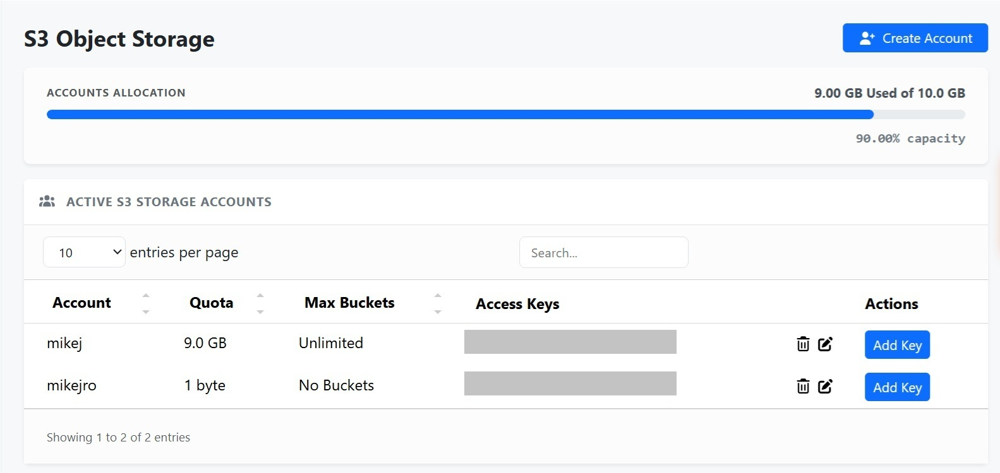

# Managing a project's S3 object store allocation

Management of a project's EIDF S3 Service object store allocation and its S3 accounts and access permissions is done by project leads.

---

## Object store allocations, S3 accounts and access keys

An **object store allocation** is a portion of the EIDF S3 Service storage allocated for the exclusive use of a project. A project's S3 buckets are created within this object store allocation.

Each S3 bucket, and the objects within that bucket, is owned by an **S3 object store account** (hereon called an **S3 account** or **account**). S3 accounts are created by a project lead.

Each account has a **storage quota**, the maximum amount of storage, from the project's object store allocation, that the account can use. The storage quota is defined by a project lead. The sum of all account quotas is limited by the total storage quota of a project's object store allocation.

Each account also has a **bucket quota**, the maximum number of buckets allowed for the account. The bucket quota is also defined by a project lead.

To create and access buckets, users need both an **access key** and a **secret**. An account can have zero or more access keys, each with an associated secret.

The number of buckets that a user can create and volume of files they can upload is constrained by both the bucket and storage quotas defined for the account associated with the access key used by the user.

---

## Request an S3 allocation

An object store allocation is the storage allocated within the EIDF S3 Service for a specific project.

You can request an EIDF S3 Service object store allocation for your project via the [EIDF Helpdesk](https://portal.eidf.ac.uk/queries/submit).

---

## View and manage object store allocation

You can view and manage your project's S3 object store allocation via the [EIDF Portal](https://portal.eidf.ac.uk/):

1. On the EIDF portal's [Your Projects](https://portal.eidf.ac.uk/project/) page, click your project.
1. Your select project's page will appear.
1. Click **S3 Object Storage**, or, if using the 'classic' view, click **S3 Allocation**.
1. The 'S3 Object Storage' (default view) or 'S3 Allocation' ('classic' view) section will show the following:
    * **Accounts allocation**: Project's object store allocation and current usage (default view only).
    * **Quota**: Project's object store allocation ('classic' view only).
    * For each S3 account:
        * **Name**: Account name.
        * **Quota**: Maximum amount of storage available to the account.
        * **Max Buckets**: Maximum number of buckets allowed for the account.
        * **Access Keys**: Access keys associated with this account.

{: class="border-img"}

---

## Create an S3 account

To create an S3 account, within the 'S3 Object Storage' (default view) or 'S3 Allocation' ('classic' view) section:

1. Click **Create Account**, or, if using the 'classic' view, click **Add Account**.
1. A 'Create S3 Object Store Account' page will appear.
1. Enter:
    * **Account name**: Only letters, numbers, and underscore `_`, are allowed.
    * **Display Name**: Alternative name for display. Spaces are allowed.
    * **Maximum number of buckets allowed**: Select:
        * **None**: If selected, then this account cannot have any buckets. If selected, then leave  **Number of buckets** empty.
        * **Unlimited**. If selected, then leave  **Number of buckets** empty.
        * **Or choose a limit:** If selected, then enter the number of buckets in **Number of buckets**.
    * **Quota**: Maximum amount of storage available to this account. Enter both the number and the storage unit, one of 'B', 'kB', 'MiB' (MB), 'GiB' (GB), or 'TiB' (TB). The minimum quota is 1B (i.e., 1 byte).
1. Click **Create Account**.

The account will be created along with an access key and associated secret.

!!! Warning "Account quotas and project S3 storage quota"

    You cannot create an account with a quota greater than the project's total S3 storage quota.

!!! Warning "Accounts with an 'Unlimited' quota"

    If you create an account with a quota of 'Unlimited', then you will not be able to create any another accounts.

!!! Tip "Troubleshooting: `Failed to create account: name already in use`"

    S3 account names must be unique within your project.

    This error can sometimes arise if you try to reuse the name of an account that you have previously deleted. Accounts are never deleted but are marked as 'retired'.

It may take a little while for the account to become available.

Refresh the project page to update the list of accounts.

### Create an S3 account for collaboration

It is possible to create an S3 account that has the maximum number of buckets set to zero, and with a minimum storage quota of 1B. While this account cannot be used to create buckets or upload files into your own project's buckets, it can be useful when collaborating with another project which also has buckets hosted within the EIDF S3 Service.

Given only your project name and the account name, your collaborator can apply an S3 policy to one of their buckets to grant this account access to their bucket, for example to read files from or write files to their bucket. For example, see [Grant read-only access to another project's S3 account](./policies.md#grant-read-only-access-to-another-projects-s3-account).

Your project members can then interact with the collaborator's bucket using the access key for this account.

To revoke your access, the collaborator changes or reverts their bucket's policy.

Granting access in this way makes collaboration easier for your collaborator, as they don't need to worry about creating accounts, access keys and secrets for use by your project.

Use of such an account also allows for you to keep a separation between accounts you use to access your own project's buckets and accounts you use to access those of your collaborator. It also allows for your project members to be given access to your collaborator's buckets, but not your own, if required.

## Delete an S3 account

To delete an S3 account, within the EPCC [SAFE](https://safe.epcc.ed.ac.uk):

1. Select **Projects** menu, your project project ID e.g., 'eidfNNN'.
1. A 'Project' page will appear.
1. Under 'Object store quotas', click **CephS3**.
1. A '(CephS3)-(eidfNNN)' page will appear.
1. Click **List accounts**.
1. An 'Account list' page will appear.
1. Click S3 account name.
1. Click **Remove**.
1. An 'Are you sure you want to remove this S3 account?' dialog will appear.
1. Click **Yes**.

!!! Warning "S3 account names cannot be reused"

    S3 accounts are never deleted but are marked as 'retired'. This means that you cannot reuse the names of accounts you have previously deleted.

---

## Create an access key and secret

To create an access key for an S3 account, within the 'S3 Object Storage' (default view) or 'S3 Allocation' ('classic' view) section:

1. Click **Add Key** in the account's table row.
1. An 'Add Access Key' page will appear.
1. Click **Create Access Key**.

The access key will be created along with an associated secret

It may take a little while for the account to become available.

Refresh the project page to update the list of access keys.

---

## Set access key permissions

You can control which project members are allowed to view each access key and secret within the EIDF Portal.

To grant view permissions for an access key to a project member, within the 'S3 Object Storage' (default view) or 'S3 Allocation' ('classic' view) section:

1. Click on the **Edit** icon next to the key.
1. A 'Set Access Key Permissions' page will appear.
1. Select the project members that will have view permissions for this access key.
1. Click **Update Permissions**.

It can take a little while for the permissions update to complete.

!!! Warning "View permissions do not constrain access key and secret usage"

    Anyone who knows an access key and secret will be able to use these to interact with the EIDF S3 Service, regardless of the view permissions on the access key. These permissions apply to the EIDF Portal only.

---

## Delete an access key

To delete an access key for an S3 account, within the 'S3 Object Storage' (default view) or 'S3 Allocation' ('classic' view) section:

1. Click on the "bin" icon next to a key.
1. A 'Delete Access Key' dialog will appear.
1. Click **Delete**.
